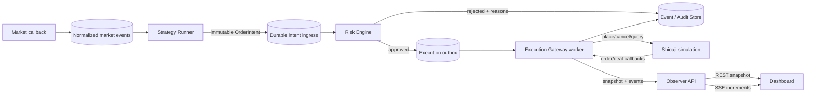

# 下單程式修正 v1 案

> **狀態：PAUSED（2026-09-14）**
>
> 本案的既有實作、測試及稽核證據全部保留，但不再作為目前的主動開發路線。產品開發已改以
> [`shioaji-pro-autotrade-refactor-plan.md`](shioaji-pro-autotrade-refactor-plan.md)
> 為主：直接以 `Sinotrade/shioaji-pro-app` 的公開 Web 版為上游基底，補入本專案既有的自動下單能力。
> 本案尚未完成的 soak、remote CI、review、tag、strategy opt-in 與 legacy `UNKNOWN` gate 暫停累積，
> 不得因暫停而改寫為 PASS。`SIM`、`DISARMED`、CA disabled、未知委託不得重送等安全邊界仍然有效。

> 文件狀態：Draft v1.0，待確認
>
> 建立日期：2026-09-14（Asia/Taipei）
>
> 適用專案：Autotrade Observer
>
> 適用環境：Shioaji simulation、local operator、Tailscale remote observer
>
> 不包含：CA 啟用、正式盤、正式帳戶下單、提高風險額度或自動平倉

## 1. 文件目的

本文件將 2026-09-14 實作稽核發現的問題轉換成可執行的修正規格，作為程式設計、測試、Git review、部署及重新驗收的共同準則。

本案完成前，不得以「測試大多通過」、「canary 曾成功」、「服務目前健康」或「Paper Soak report 顯示 accepted」單獨宣告 simulation 功能完整。完成判定必須同時具備：

1. 程式行為符合本文件的資料與安全契約。
2. 自動化測試涵蓋正常、失敗、重啟及重複事件情境。
3. 在乾淨環境可重現建置與測試結果。
4. 部署後重新產生的運行證據通過，不沿用修正前的 soak 或備份數字。
5. 所有實作存在於可回復、可稽核的 Git commit；工作樹乾淨。

### 1.1 規範用語

- **MUST／必須**：未符合即不得合併或宣告完成。
- **MUST NOT／不得**：安全或一致性禁止事項。
- **SHOULD／應**：原則上要做到；若不做，PR 必須記錄原因、風險與替代控制。
- **MAY／可**：不影響 v1 驗收的選配實作。

## 2. 稽核結論與修正範圍

### 2.1 已確認可沿用的能力

- Shioaji simulation session、行情 callback、受控 canary、取消及重啟對帳已有實際成功證據。
- 2330 現股 1 張 canary 的 broker id 為 `01F533`，最終為 `CANCELLED`、0 成交，交易閘門回到 `DISARMED`。
- 本機 API、simulation worker、PostgreSQL、Tailscale Serve observer 可啟動並回報健康。
- 遠端 observer 對 mutation request 回覆 `403`。
- 現有後端測試為 85 passed、1 skipped；乾淨 PostgreSQL 測試資料庫的 store contract 可通過。
- 前端 lint、build 及手動桌面／390px 煙霧測試可通過。
- 修正前資料具有 407 小時以上事件時間窗，且沒有 `UNKNOWN`、`RECONCILING` 或 `MANUAL_REVIEW` 訂單。

以上證據只能作為修正起點，不得取代本案完成後的重新驗收。

### 2.2 待修正項目

| ID | 優先級 | 問題 | 目前風險 | v1 結果 |
|---|---|---|---|---|
| FIX-01 | P1 | 空的 PostgreSQL backup 被算入 Paper Soak | 無法在故障時還原，readiness 假陽性 | 原子備份、內容驗證、時效與還原門檻 |
| FIX-02 | P1 | SSE 輸出字面 `\\n` | UI 顯示 LIVE 但沒有近即時事件 | 合法 SSE framing、游標續傳及 browser E2E |
| FIX-03 | P1 | Strategy Runner 未接到一般下單鏈路 | 只能證明固定 canary，不能證明自動策略 | 建立 durable strategy intent ingress 與端到端流程 |
| FIX-04 | P1 | 實作未形成 Git 穩定基線 | 無法可靠 review、回復、執行 CI 或發布 | 建立基線 commit、修正分支、CI 與 release tag 規則 |
| FIX-05 | P2 | K 線 timestamp 誤標 UTC | 台北 UI 顯示時間多 8 小時 | 明確市場時區契約與固定 fixture |
| FIX-06 | P2 | Order outbox 永遠 pending | queue depth 失真，缺乏可靠派送語意 | claim／lease／complete／failure 狀態完整化 |
| FIX-07 | P2 | 「活動委託」包含終態訂單 | 使用者可能誤判仍有掛單 | active 與 history 分離，前後端共用狀態定義 |
| FIX-08 | P2 | runtime log 留存未遮罩個資 | 本機 log 洩漏客戶識別資訊與 IP | allowlist logging、遮罩、權限與保留期限 |
| FIX-09 | P2 | PostgreSQL test 在 CI 被跳過且不隔離 | 關鍵 backend 沒有持續驗證 | CI PostgreSQL service、每次測試獨立資料範圍 |
| FIX-10 | P3 | 終態訂單殘留 recovery error | UI 與 audit 顯示互相矛盾 | 狀態轉移原子清理錯誤欄位 |
| FIX-11 | P3 | terminal reconciliation 重複寫事件 | event store 無限增長、訊號雜訊 | 對帳範圍與事件去重 |
| FIX-12 | P2 | 遠端安全只在同一主機驗證 | 未證明第二裝置與 tailnet policy | 第二裝置、ACL/MFA、header 與 mutation matrix 驗證 |
| FIX-13 | P3 | 完整看盤只有 K 線表格 | 未達原規劃的可視化需求 | 加入實際 candlestick chart，表格保留為輔助 |

## 3. v1 安全邊界與不可變規則

### 3.1 環境與交易授權

1. v1 MUST 維持 `simulation=true`，不得建立正式 Shioaji session。
2. v1 MUST NOT 呼叫 CA 啟用流程，也不得新增正式憑證欄位、正式下單開關或自動平倉。
3. 每次 API、worker、Strategy Runner 或部署重啟後，交易閘門 MUST 為 `DISARMED`。
4. 程式修正與測試不得被解讀為 canary 授權。實際 simulation canary 仍須由使用者逐次明確授權。
5. Shioaji simulation 不支援盤中零股；實際 simulation canary MUST 使用受支援的現股整張規格。零股只做 adapter contract／mock 驗證。

### 3.2 元件權限

- **Strategy Runner**：只能產生內部 `OrderIntent`；不得匯入、取得或呼叫 Shioaji client。
- **Execution Gateway worker**：唯一可持有 Shioaji session 的程序；所有實際 broker mutation 必須在此執行。
- **Risk Engine**：是每筆 intent 的 server-side 必經關卡；策略、UI、operator queue 均不得繞過。
- **Observer API/UI**：遠端只讀；不得提供一般手動下單 endpoint。
- **Local operator**：只允許既有的 arm、disarm、kill、cancel、reconcile 等受控操作；必須具備 loopback、token、trusted Origin、reason、idempotency key 與 audit。

### 3.3 故障安全

- 無法判定訂單是否到達券商時，MUST 進入 `UNKNOWN`／`RECONCILING`，不得直接重送。
- 行情 stale、worker stale、DB degraded、strategy heartbeat stale、outbox 卡住或對帳不一致時，MUST 阻擋新單並保持／切回 `DISARMED`。
- rollback、服務重啟與 queue recovery MUST NOT 自動重播可能已送達券商的訂單。
- 所有修正 MUST 保留既有事件與訂單稽核鏈，不得修改歷史事件來製造通過結果。

## 4. 目標資料流



資料流必須具備下列特性：

- 每個 `OrderIntent` 有全域唯一 `intent_id`、`strategy_id`、`strategy_version`、參數 checksum、產生時間、有效期限與理由。
- `intent_id` 是系統冪等主鍵；同一 intent 不得產生第二個 broker order。
- broker identity、client memo／custom field 與本地 intent 的對應必須可在重啟後重建。
- signal → intent → risk decision → outbox → broker order → callback／fill 全程使用同一 correlation id。
- Query API 提供 snapshot；SSE 只提供可依 sequence 接續的增量事件。

## 5. FIX-01：PostgreSQL 備份與 Paper Soak 修正

### 5.1 備份命令與 launchd 環境

`scripts/backup_postgres.py` MUST：

1. 使用 `shutil.which()` 在建立檔案前解析 Docker binary，或接受明確的 `AUTOTRADE_DOCKER_BIN` 絕對路徑。
2. 找不到 binary 時立即失敗，不得先建立目的檔案。
3. launchd plist MUST 提供最小且明確的 `PATH`，或直接傳入 Docker 絕對路徑；不得依賴互動式 shell profile。
4. 先輸出至同目錄的唯一暫存檔，例如 `.<name>.partial-<uuid>`。
5. `pg_dump`、非零大小檢查與 `pg_restore --list` 全部成功後，才以原子 `os.replace()` 發布正式 `.dump`。
6. 任一步失敗都 MUST 刪除暫存檔，且不得留下看似有效的 `.dump`。
7. stdout/stderr 不得包含 DSN 密碼、API key、帳號或原始環境變數。
8. 成功後產生不含秘密的 manifest，至少包含檔名、bytes、SHA-256、database label、建立時間、驗證時間、pg_dump/pg_restore 版本及結果。

### 5.2 Paper Soak 驗證語意

`scripts/paper_soak_report.py` 不得再用 `bool(backups)` 判定成功。報告 MUST 區分：

- `backup_count_total`
- `backup_count_valid`
- `backup_count_invalid`
- `latest_valid_backup`
- `latest_valid_backup_bytes`
- `latest_valid_backup_age_hours`
- `restore_drill_status`
- `restore_drill_at`
- `backup_job_last_exit_code`

PostgreSQL backup 只有同時符合以下條件才算 valid：

1. 副檔名為 `.dump`，且不是 `.partial`。
2. 檔案大於 0 bytes。
3. `pg_restore --list` 成功。
4. manifest 存在、checksum 與實體檔案一致。
5. 建立時間不早於目前 soak marker，且最新一份不超過 26 小時。

Paper Soak `accepted=true` MUST 同時要求：

- DB health／SQLite integrity 為正常。
- 有明確的 `paper_soak.started` marker。
- marker 後時間窗達到設定門檻。
- 沒有未知、對帳中或人工覆核訂單。
- 至少 3 個不同日曆日各有 1 份有效 backup。
- 最新有效 backup 不超過 26 小時。
- marker 後至少完成一次從有效 backup 還原至新資料庫的 restore drill，並比對 schema version、event count 及最新 event sequence。
- 排程備份工作最近一次 exit code 為 0。

不符合時 CLI MUST 以非零狀態結束，報告需列出 machine-readable `rejection_reasons`，不得只輸出 `accepted=false`。

### 5.3 測試

- Unit：Docker binary 不存在時不建立 `.dump`。
- Unit：`pg_dump` 失敗、空輸出、`pg_restore` 失敗及 checksum mismatch 均移除暫存檔。
- Unit：零 bytes、過期、修正前、缺 manifest、錯 checksum 的 backup 均不算 valid。
- Integration：對臨時 PostgreSQL 建立 custom archive，驗證後還原至唯一 `_restore_test` DB，比對事件數並清除測試 DB。
- Launchd smoke：使用與排程相同的環境啟動一次，確認 exit code 0、檔案非零且可列出 archive。

### 5.4 完成條件

- 既有 17 份 0-byte 檔案只能列為 invalid evidence；不得刪除以掩蓋問題。
- 重新部署後連續 3 日產生有效 backup。
- 使用最新有效 backup 完成一次新資料庫 restore drill。
- 新 Paper Soak report 正確回報 valid／invalid 數量；不再把 22 份全部算成有效。

## 6. FIX-02：SSE 與 UI 即時狀態修正

### 6.1 SSE wire contract

每一筆事件 MUST 使用真正的 LF 結尾：

```text
id: 123
data: {"sequence":123,"type":"quote.updated"}

```

不得輸出包含 `\\n` 的字面字串。Keepalive 必須為合法 comment frame：

```text
: keepalive

```

Server MUST：

- 設定 `Content-Type: text/event-stream`、`Cache-Control: no-cache`。
- SHOULD 設定 `X-Accel-Buffering: no`，避免反向代理累積資料。
- 接受 query `after`，並支援瀏覽器重連的 `Last-Event-ID`；兩者同時存在時採較大的已驗證 sequence。
- 只在完整 frame 寫出後推進 server-side cursor。
- 依 sequence 嚴格遞增傳送；重複 sequence 不得造成 UI 重複列。
- 對過舊游標提供明確 recovery 行為：回傳需要重取 snapshot 的控制事件，或關閉讓 client 重取 snapshot，不得靜默漏資料。

### 6.2 前端連線狀態

前端不得僅因 `EventSource.onopen` 就長期顯示 `LIVE`。狀態定義如下：

- `CONNECTING`：尚未完成連線。
- `LIVE`：在 freshness 門檻內收到合法 SSE event 或 keepalive，且 snapshot 也成功。
- `RECONNECTING`：EventSource error、frame parse error 或超過 keepalive 門檻。
- `POLLING`：SSE 不健康但 30 秒 fallback snapshot 仍成功。
- `STALE`：SSE 與 snapshot 都超過門檻；凍結畫面並顯示資料已過期。

重連時 client MUST 將 `cursor.current` 傳回 `after`，收到事件後以 sequence 去重。fallback polling 可保留，但不得讓使用者誤認為近即時。

### 6.3 測試與效能門檻

- API integration test 必須檢查 raw bytes 中包含真正的 `\n\n`，且不存在字面 `\\n` framing。
- 測試連續 201 筆事件的分頁、游標推進、重連與無重複。
- Playwright 啟動 EventSource，寫入已知事件，2 秒內必須在 UI 出現對應 sequence。
- 模擬斷線後，UI 必須在設定門檻內顯示 `RECONNECTING/POLLING`；REST 也停止後顯示 `STALE`。
- Tailscale Serve 路徑重複上述串流測試，確認 proxy 不會 buffer。

## 7. FIX-03：Strategy Runner 自動下單鏈路

### 7.1 v1 範圍

v1 只建立「內建 Python strategy → durable intent → Risk Engine → simulation broker」鏈路。不得加入公開 webhook、瀏覽器手動下單或正式盤。

至少提供一個無投資意義、預設停用的 reference strategy，用 fixture 市場事件驗證鏈路。reference strategy 不得在部署後自行 arm，也不得自行執行實際 canary。

### 7.2 Strategy lifecycle

每個策略 MUST 有：

- `strategy_id`、`version`、config checksum。
- `STOPPED`、`STARTING`、`RUNNING`、`PAUSED`、`ERROR` 狀態。
- heartbeat、最後處理 event sequence、最後錯誤類型與停止理由。
- 訂閱商品 allowlist 與 intent rate limit。
- 可重現的輸入 event id；相同 event 不得產生不同 intent id。

策略 exception 只能將該策略改為 `ERROR` 並停止新 intent，不得終止 Execution Gateway。Strategy Runner heartbeat stale 時，Risk Engine MUST 拒絕該策略的新 intent。

### 7.3 Durable intent ingress

不得把 operator request queue 改成一般策略入口。新增或正式定義獨立的 durable intent ingress，其資料至少包含：

- `intent_id` primary key
- immutable payload JSON
- `strategy_id`／`strategy_version`／config checksum
- `correlation_id`
- `created_at`／`expires_at`
- `state`：`PENDING`、`CLAIMED`、`ACCEPTED`、`REJECTED`、`UNKNOWN`、`COMPLETED`
- `claimed_by`／`claimed_at`／`lease_until`
- `attempt_count`、`last_error_code`

claim MUST 使用資料庫互斥語意；PostgreSQL 建議 `FOR UPDATE SKIP LOCKED`。worker crash 後只有「尚未開始 broker mutation」的工作可以安全重領。

### 7.4 Broker mutation 原則

1. 先持久化 intent 與風控結果，再進入 broker 呼叫。
2. 呼叫前保存可供 broker 對帳的 identity／memo 映射；Shioaji `custom_field` 必須遵守最多 6 位英數限制。
3. `place_order()` 回傳 broker identity 後立即持久化。
4. callback 是主要狀態來源；`update_status()`／trades snapshot 只用於啟動、漏事件與低頻對帳。
5. crash 發生在 broker 呼叫前，可重新 claim；發生在呼叫期間或回傳持久化前，MUST 標示 `UNKNOWN` 並以 identity 對帳，不得盲目 retry。
6. 相同 `intent_id` 再次提交時，回傳原紀錄；不得建立第二張單。
7. 所有 broker mutation 只能由唯一 Execution Gateway worker 執行。

### 7.5 測試

- reference strategy 對固定行情 fixture 產生完全一致的 intent。
- strategy exception、heartbeat stale、過期 intent、重複 market event 均不送單。
- mock broker 驗證 signal → intent → risk → outbox → broker → callback → terminal order 全鏈路。
- fault injection 覆蓋 crash-before-send、timeout-during-send、crash-after-broker-id、duplicate callback、out-of-order callback 及 restart reconciliation。
- 實際 Shioaji simulation canary 仍是獨立、需授權的最後證據；不得讓 CI 或部署自動執行。

## 8. FIX-06：Execution outbox 語意修正

### 8.1 狀態與欄位

現有 `dispatched_at IS NULL` 無法表達 claim、失敗或未知狀態。v1 outbox SHOULD 至少具備：

- `id`、`topic`、`intent_id`、`payload`
- `created_at`、`available_at`
- `state`：`PENDING`、`CLAIMED`、`DISPATCHED`、`UNKNOWN`、`DEAD_LETTER`
- `claimed_by`、`lease_until`
- `attempt_count`、`last_error_code`
- `dispatched_at`

若沿用現有 schema，至少 MUST 在成功 broker handoff 後呼叫 `mark_dispatched`，並另以 durable 欄位表達 ambiguous outcome；不得以刪除 outbox row 代表成功。

### 8.2 交易 outbox 的特殊規則

- 一般 message 可依政策重試；broker order mutation 不得套用通用無限 retry。
- broker timeout 對應 `UNKNOWN`，先 reconcile，再決定終態。
- `outbox_pending_count` 必須只計算真正待處理項目。
- 增加 `outbox_oldest_age_seconds`、`outbox_unknown_count`、`outbox_dead_letter_count`。
- 交易時段內 pending age 超過 30 秒 SHOULD 告警；超過 60 秒 MUST 阻擋新單並 disarm。
- terminal intent 對應的 outbox 不得永久 pending。

### 8.3 資料遷移

既有兩筆 canary pending outbox 不得直接批次標成功。遷移工具 MUST：

1. 以 `intent_id` 關聯本地 order。
2. 對 terminal order 且有完整 broker／audit 證據者，標記為 migration-reconciled，保留原因與操作者。
3. 無法證明者標示 `UNKNOWN`，保持 `DISARMED` 並人工處理。
4. 寫入 migration event，記錄舊值、新值、規則版本與時間。

## 9. FIX-05：市場時間契約

### 9.1 統一規則

- 所有「真實時間點」在資料庫與 API 內使用 timezone-aware ISO-8601。
- 系統事件、接收時間與 audit timestamp 儲存為 UTC。
- Shioaji KBar 的 nanosecond timestamp 必須依官方 fixture 解讀為台灣市場 wall-clock，使用 `zoneinfo.ZoneInfo("Asia/Taipei")` 明確標記，禁止依賴主機本地時區。
- API 可回傳 `+08:00` 或正確換算後的 `Z`，但兩者代表的 instant 必須相同。
- UI 只做顯示時區轉換，不得再次補固定 8 小時。
- UI 同時顯示市場資料時間與接收時間；不可混用。

### 9.2 測試 fixture

- 使用 Shioaji 官方歷史資料範例建立固定 raw-nanosecond → `Asia/Taipei` 預期時間 contract test。
- 加入 09:00、13:30、跨日、非交易日與 DST 無影響測試。
- Browser timezone 分別以 `Asia/Taipei` 與 `UTC` 執行，畫面都要代表相同 instant；台灣使用者預設顯示市場時間。
- 驗證 2026-09-14 的 13:26 市場 bar 不得顯示為 21:26。

參考：[Shioaji historical market data](https://sinotrade.github.io/tutor/market_data/historical/)。

## 10. FIX-07／FIX-13：Dashboard 語意與看盤 UI

### 10.1 活動委託

後端與前端 MUST 共用下列 active 定義：

- active：`APPROVED`、`SENDING`、`PENDING_SUBMIT`、`SUBMITTED`、`PART_FILLED`、`UNKNOWN`、`RECONCILING`
- terminal：`RISK_REJECTED`、`FILLED`、`CANCELLED`、`FAILED`、`REJECTED`、`MANUAL_REVIEW`

「活動委託」只能顯示 active。另建「最近委託／歷史」區顯示 terminal，並提供狀態、時間、策略與商品篩選。`UNKNOWN`、`RECONCILING` 必須置頂並顯示高風險提示。

API SHOULD 提供明確的 `active_orders` 與 `recent_orders`，避免前端自行複製狀態集合。摘要卡的 active count 必須等於活動委託列數。

### 10.2 K 線

- 使用經審核授權的 candlestick library；若採 TradingView Lightweight Charts，需保留必要 attribution 並鎖定版本。
- 圖表顯示 OHLC、成交量、資料時間、interval 與 stale 狀態。
- 商品切換時取消或忽略舊 request，避免舊商品資料覆蓋新畫面。
- 空資料、API error、資料過期與 loading 必須是不同 UI 狀態。
- 現有表格可保留為可存取性／除錯輔助，但不得再把表格本身稱為完整 K 線功能。

### 10.3 E2E

- 一鍵切換簡潔／完整模式並保留商品與使用者偏好。
- 桌面及 390×844 不得水平截斷關鍵風險資訊。
- active count 與列表一致；取消後訂單移至最近委託。
- SSE 更新、fallback polling、stale banner 及重連均有 Playwright 測試。
- 遠端 observer 不渲染 mutation 控制元件。

## 11. FIX-08：Log 與個資保護

### 11.1 Logging contract

Runtime log 採 allowlist structured fields。可記錄：component、severity、event code、correlation id、intent id、遮罩後 broker order id、exception class 與時間。

不得記錄：

- API key、secret key、CA 密碼或憑證內容。
- 完整身分證號、券商帳號、手機、email、session/token。
- 完整 public/private IP；非必要時完全不記錄，必要時遮罩或不可逆雜湊。
- Shioaji SDK 的原始 exception／response body，除非先經過 sanitizer。
- 完整環境變數、DSN 或 request headers。

第三方 SDK 直接寫 stderr 時，啟動 wrapper MUST 先經過 sanitizer，或調整 SDK logger handler／level，避免原文落盤。只在輸出後用 regex 掃描不是充分控制；應優先不產生敏感字串。

### 11.2 檔案與保留

- Log 目錄與檔案權限分別 SHOULD 為 `0700`、`0600`。
- 啟用 size/time rotation，simulation 一般 log 建議保留 14 日；security audit 依另定政策保存。
- log、backup、runtime DB 持續位於 `.gitignore`，且 secret scan 同時掃描 tracked、staged 與建置產物。
- 既有含個資 log 不得提交。確認不再需要調查後，以可稽核方式輪替／安全移除；移除前先確認不影響必要 audit evidence。

### 11.3 測試

- 用合成的身分證格式、帳號、token、IPv4/IPv6 及 DSN fixture 驗證 sanitizer。
- 觸發模擬 SDK exception，assert captured log 不含 fixture 原值。
- CI secret scan MUST NOT 讀取或輸出真實 `.env`／runtime log 內容。

## 12. FIX-09：PostgreSQL 與 CI

### 12.1 測試隔離

PostgreSQL integration test MUST 在每次 run 使用獨立 database 或 schema。禁止用整張 `pending_outbox()` 必須只含一筆來假設資料庫原本為空；測試資料必須以本次 UUID／intent id 查詢與清理。

測試 fixture MUST：

1. 驗證 DSN 指向專用 test database。
2. 建立唯一 schema/database。
3. 執行 migration。
4. 執行測試。
5. 即使 assertion 失敗也在 teardown 清理。

不得連接 simulation 或 production 使用中的 `autotrade` database。

### 12.2 GitHub Actions

Backend CI MUST 啟動 PostgreSQL service 並設定 `AUTOTRADE_TEST_POSTGRES_DSN`。CI 對必需 integration test 不得使用 skip 當作通過；建議新增獨立 marker 與 job：

```text
unit-and-static
postgres-integration
frontend
ui-e2e
repository-safety
```

每個 job 都必須在 pull request 顯示明確狀態。`pytest -ra` 輸出若出現非 allowlist skip，CI MUST 失敗。Shioaji 實際 simulation 測試不放入一般 CI，改為人工授權的受控驗收 job／runbook。

### 12.3 必要 CI 檢查

- Python：ruff、mypy（逐步擴至 `apps` 與全部 `packages`）、pytest unit/integration。
- Frontend：`npm ci`、lint、TypeScript build、Playwright。
- Storage：SQLite 與 PostgreSQL contract、migration、backup/restore fixture。
- Security：secret scan、dependency audit、license check；container scan 可在 v1 後半納入。
- Artifact：保存 sanitized test report，不保存 `.env`、DB、broker raw log 或憑證。

## 13. FIX-10／FIX-11：Recovery 狀態與事件去重

### 13.1 `last_error` 規則

- `last_error` 只代表目前仍成立的錯誤，不是歷史紀錄。
- 進入正常 terminal 狀態 `FILLED`／`CANCELLED` 時，MUST 在同一 transaction 將 transient recovery error 清為 `NULL`。
- 歷史錯誤保留於 immutable domain event／audit，不應殘留在 current read model。
- `FAILED`／`REJECTED` 可保留對應 error code，但不得保存包含敏感資料的原始 exception。
- duplicate callback 即使狀態未改變，也要檢查 current record 是否有應清除的 transient error；不能在 cleanup 前直接 return。

### 13.2 Reconciliation 去重

- 週期對帳預設只查 active、unknown、reconciling 及需要校正的近期訂單。
- 已達 terminal 且 broker identity、filled quantity 與本地一致者，不得每輪產生 `broker.order_duplicate`。
- 事件 dedup key SHOULD 包含 broker order identity、normalized status、filled quantity、broker event time／sequence。
- 完全相同 callback 只更新去重 metric，不寫新的 domain event。
- 發現 terminal 狀態或成交量改變時仍必須寫 event，不能因去重漏掉真實變化。

### 13.3 驗收

- 對同一 `CANCELLED` snapshot 重跑 100 次 reconciliation，domain event count 不增加。
- `CANCELLED`／`FILLED` current record 的 transient `last_error` 為 `NULL`。
- 亂序 callback 不得讓 terminal order 回退至 active 狀態。

## 14. FIX-12：遠端 observer 安全驗證

### 14.1 應用與網路控制

- Remote observer process 只掛載 query、health、metrics 與 SSE route；operator route 應在 router 層不註冊，或一律 403。
- Tailscale Serve 必須維持 tailnet-only；不得啟用 Funnel、public port forwarding 或直接暴露 Execution Gateway。
- tailnet 管理面 MUST 確認 MFA、裝置核准、ACL、離職／遺失裝置撤銷與最小使用者範圍。
- TLS response SHOULD 包含 HSTS；保留 CSP、frame deny／`frame-ancestors`、nosniff、referrer policy、permissions policy 與合理 read rate limit。
- 前端不得收到 raw broker payload、秘密、完整帳號或非必要個資。

### 14.2 驗證矩陣

必須從另一台已核准 tailnet 裝置驗證：

| 測試 | 預期 |
|---|---|
| Dashboard GET | 200，帳號遮罩，READ ONLY |
| Summary／orders／positions／fills／health GET | 200，無秘密欄位 |
| SSE | 可持續收到合法 frame，不被 proxy buffer |
| arm／disarm／kill POST | 403 或 route 不存在 |
| cancel／reconcile POST | 403 或 route 不存在 |
| 任意手動下單 route | 不存在 |
| 無 tailnet 身分的裝置 | 無法連線 |
| 被撤銷裝置 | 撤銷後無法連線 |

驗證證據只能保存遮罩後的 status、timestamp、route 與 response code；不得保存 session cookie 或完整 Tailscale identity token。

## 15. Git 實施規則

### 15.1 建立穩定基線

目前只有規劃文件 commit，而實作仍全部 staged。開始改程式前 MUST：

1. review staged diff，確認沒有 `.env`、憑證、runtime DB、backup、log、build artifact 或個資。
2. 重新執行現況測試並保存 sanitized 結果。
3. 將「修正前、已知問題存在」的程式建立明確 baseline commit；commit message 不得宣稱功能完整。
4. 從 baseline 建立 `codex/fix-order-remediation-v1` 或團隊核准的短生命週期分支。
5. 設定 remote 與受保護 `main`；若尚未選定 remote，至少建立本機 annotated baseline tag 並備份 repository，但不得把含秘密資料的工作目錄整包上傳。

本文件建立本身不代表授權建立 commit、tag 或 remote；執行時仍由使用者確認 repository 目的地。

### 15.2 建議 commit 邊界

每個 commit 必須單一目的且可獨立 review：

1. `docs: add order execution remediation v1 plan`
2. `fix: make postgres backups atomic and verifiable`
3. `fix: emit valid resumable server sent events`
4. `fix: normalize shioaji market timestamps`
5. `fix: complete execution outbox lifecycle`
6. `feat: connect strategy intents to simulation execution`
7. `fix: separate active and historical orders in dashboard`
8. `feat: add candlestick market view`
9. `fix: sanitize broker runtime logs`
10. `test: require postgres and browser integration coverage`
11. `fix: clean terminal recovery state and deduplicate events`
12. `docs: update runbooks and completion audit`

不得使用會遺失使用者修改的 `git reset --hard`、廣泛 checkout 或無審查的歷史重寫。不得把不同修正 squash 成無法稽核的大型 commit，除非 PR merge policy 明確要求且 PR 仍保留逐步 review 證據。

### 15.3 合併門檻

- PR 必須列出對應 FIX ID、風險、測試、資料遷移及 rollback。
- P1 修正至少一位非作者 reviewer；交易核心與遠端安全 SHOULD 指定 code owner。
- CI 全綠、無未核准 skip、secret scan 無發現。
- DB migration upgrade 與 rollback／forward-fix 路徑已演練。
- 合併後 `main` 必須乾淨且可建置；發版使用 annotated SemVer prerelease tag，例如 `v0.2.0-sim.1`。

## 16. 實作順序與依賴

### Phase 0：凍結與基線（0.5–1 日）

- 保持 gate `DISARMED`，暫停新的 simulation canary。
- 稽核 staged diff 與秘密，建立修正前基線。
- 將本文件核准版納入 Git。
- 保存目前 schema version、Shioaji 版本、服務設定與遮罩後健康快照。

完成門檻：可從 baseline 重建現況，且沒有秘密進入 Git。

### Phase 1：先修正會產生錯誤安全訊號的項目（2–4 日）

- FIX-01 backup／Paper Soak。
- FIX-02 SSE。
- FIX-05 timestamp。
- FIX-08 logging。
- FIX-09 CI PostgreSQL 基礎。

完成門檻：報告不再假陽性、UI 不再假 LIVE、時間正確、runtime log 合成敏感資料被遮罩、CI 真正執行 PostgreSQL test。

### Phase 2：交易一致性（3–6 日）

- FIX-06 outbox lifecycle 與既有資料遷移。
- FIX-10 terminal cleanup。
- FIX-11 reconciliation dedup。
- fault injection 與 restart recovery。

完成門檻：pending outbox 正常歸零，ambiguous order 不重送，重複對帳不新增事件。

### Phase 3：策略端到端（4–8 日）

- FIX-03 Strategy Runner lifecycle、durable ingress、Risk Engine 與 worker 串接。
- 使用 mock broker 完成全鏈路測試。
- 使用者另行授權時，才執行一次最小 simulation canary。

完成門檻：策略 fixture 可重現產生 intent，完整 audit chain 存在，所有故障案例 fail-safe。

### Phase 4：Dashboard 與遠端（3–6 日）

- FIX-07 active/history。
- FIX-13 candlestick chart。
- Playwright desktop/mobile/reconnect/stale 測試。
- FIX-12 第二裝置遠端驗證。

完成門檻：UI 語意一致、即時狀態可量測、完整看盤達到 K 線需求、remote mutation 全部阻擋。

### Phase 5：重新 Paper Soak 與發布（至少 3 日）

- 部署候選 commit，確認版本與 checksum。
- 建立新的 soak marker；舊 407 小時不能累計。
- 連續運行至少 72 小時，完成三日有效 backup 與 restore drill。
- 產出新版 completion audit 與 prerelease tag。

完成門檻：第 18 節所有 gate 通過；正式盤仍維持未授權。

## 17. 測試執行規則

### 17.1 本機必跑

```bash
uv sync --extra dev --extra broker --extra postgres --group dev
uv run ruff check .
uv run mypy packages apps
uv run pytest -ra
uv run python scripts/verify_repository_safety.py
npm --prefix apps/web ci
npm --prefix apps/web run lint
npm --prefix apps/web run build
npm --prefix apps/web run test:e2e
```

若專案尚未加入 `test:e2e`，Phase 4 不得宣告完成。任何必需測試 skipped 都視為未通過，除非 skip 在本文件明確列為需要人工授權的 Shioaji live simulation canary。

### 17.2 測試資料原則

- 使用 sanitized fixture，不保存 broker raw PII。
- UUID、database/schema、port 與暫存目錄每次 run 唯一。
- 測試不得依賴目前持續運行的 production-like simulation DB。
- 時間測試使用 frozen clock；不得依賴當下是否開盤。
- 網路、broker、DB fault 必須可注入且結果確定。
- 測試後清理自己建立的資源，不得刪除既有使用者 DB、backup 或 log。

### 17.3 實際 simulation 驗證

只有使用者明確授權後才執行，且必須：

1. 先確認 `SIM`、帳戶遮罩、signed、行情 fresh、DB healthy、outbox empty、gate 原為 `DISARMED`。
2. 使用核准的商品、單位、數量、限價與時效。
3. 送出後立即回到 `DISARMED`。
4. 記錄 intent id、broker id、callback sequence、取消結果與 0／實際成交數量。
5. 重啟後再次以 broker snapshot 對帳。
6. 不以 canary 成功取代 mock fault injection、CI 或 soak。

## 18. v1 完成驗收矩陣

以下全部通過，才可將 simulation 修正案標為完成：

| Gate | 必要證據 | 通過標準 |
|---|---|---|
| Git | branch、PR/review、commit、tag、clean status | 所有程式可追蹤、無秘密、可由 tag 重建 |
| Static/Unit | ruff、mypy、unit report | 全通過，無未核准 skip |
| PostgreSQL | CI service integration report | 每次乾淨隔離執行且通過 |
| Backup | 3 日 manifest、archive check、restore report | 3 份以上有效、0 份被誤算、最新可還原 |
| SSE | raw framing test、Playwright、Tailscale stream | 2 秒內收到事件，重連無漏單／重複 |
| Time | backend fixture、browser timezone E2E | 13:26 市場資料顯示為 13:26 台北時間 |
| Outbox | metrics、migration audit、restart tests | 正常 pending 為 0；ambiguous 不重送 |
| Strategy | mock end-to-end audit chain | signal 到 terminal order 可完整追溯 |
| Recovery | fault injection、restart reconciliation | 無重複 broker order，終態不回退 |
| UI | desktop/mobile E2E | active/history 正確、stale 不冒充即時 |
| Privacy | sanitizer tests、runtime scan | 無未遮罩秘密或個資 |
| Remote | 第二裝置測試矩陣 | reads 正常、所有 mutation 被阻擋 |
| Soak | 新 marker 後 report | ≥72 小時、零未知訂單、備份及 restore 全通過 |
| Production | config/audit | CA、LIVE、正式下單仍未啟用 |

若任何 P1 未完成，整案狀態只能是 `BLOCKED`。P2 未完成不得標為 `READY_FOR_SIMULATION_SOAK`。P3 可在風險接受文件中延後，但不得錯誤宣稱對應功能已完成。

## 19. Rollback 與異常處理

### 19.1 部署前

- gate 設為 `DISARMED`。
- 確認沒有 active／unknown order；若有，先人工對帳。
- 建立並驗證可還原 backup。
- 記錄目前 release commit、schema version 與 worker identity。

### 19.2 部署失敗

1. 停止 Strategy Runner，阻止新 intent。
2. 保持／設定 gateway 為 `DISARMED`。
3. 停止有問題的 worker；不得清空 queue 或重送 intent。
4. 從 broker snapshot 與本地 store 對帳 active／unknown order。
5. 若只需程式 rollback，部署前一個已驗證 tag；啟動後仍保持 `DISARMED`。
6. 若 schema 無法向後相容，優先 forward-fix；只有完成備份、restore drill 且確認不遺失稽核事件時才還原 DB。
7. 所有服務健康、outbox 狀態可解釋、broker 對帳一致後，才可考慮重新 arm。

### 19.3 禁止事項

- 不得因 rollback 自動重新送出 queue 中的 order mutation。
- 不得刪除未知訂單或歷史 event 來讓健康檢查變綠。
- 不得覆寫原 DB 或唯一 backup。
- 不得以 `git reset --hard` 清除未確認的使用者變更。
- 不得在異常期間啟用 LIVE／CA。

## 20. 文件與稽核更新

修正實作必須同步更新：

- `docs/architecture/completion-audit.md`：改成逐項引用新版證據；舊假陽性明確註記為 superseded。
- `docs/runbooks/mac-mini-launchd.md`：Docker PATH、backup failure、log sanitizer、服務檢查與告警。
- `docs/runbooks/postgresql-staging.md`：有效 backup、manifest、restore drill 及測試 DB 隔離。
- `docs/runbooks/tailscale-observer.md`：第二裝置、ACL/MFA、SSE 及 mutation matrix。
- `docs/architecture/shioaji-1.7.4-contract.md`：timestamp、callback、custom field、simulation 零股限制。
- `README.md`：只描述已通過的能力；未完成項目標示限制。

新版 completion audit MUST 包含：release commit、Git tag、CI run、測試數與 skip 原因、Shioaji 版本、DB backend、soak marker、有效／無效 backup 數、restore drill、remote test、已知限制，以及 `SIM/DISARMED/CA disabled` 證據。

## 21. 交付物清單

- [ ] FIX-01 至 FIX-13 對應程式、migration 與測試。
- [ ] PostgreSQL CI 與 Playwright E2E。
- [ ] 可驗證 backup manifest 與 restore drill report。
- [ ] Strategy Runner → simulation execution 的完整 audit chain。
- [ ] 第二裝置 remote observer 驗證報告。
- [ ] 更新後 runbooks、Shioaji contract 與 completion audit。
- [ ] 可重建的 Git prerelease tag。
- [ ] 使用者確認的 simulation readiness 結論。
- [ ] 明確記錄正式盤、CA 與正式下單仍未啟用。

## 22. 參考資料

- [原 DEVELOPMENT_PLAN](../../DEVELOPMENT_PLAN.md)
- [目前 completion audit](completion-audit.md)
- [Shioaji 1.7.4 contract](shioaji-1.7.4-contract.md)
- [Shioaji Simulation Mode](https://sinotrade.github.io/tutor/simulation/)
- [Shioaji Stock Orders](https://sinotrade.github.io/tutor/order/Stock/)
- [Shioaji Update Status](https://sinotrade.github.io/tutor/order/UpdateStatus/)
- [Shioaji Historical Market Data](https://sinotrade.github.io/tutor/market_data/historical/)

> 風險聲明：本文件是軟體修正與驗收規格，不構成投資建議，也不授權任何正式或模擬委託。任何實際 simulation canary 與未來正式交易都必須由使用者另行明確核准。
