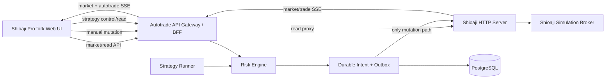

# Shioaji Pro 自動下單平台程式重構案

> 文件狀態：IN PROGRESS（2026-09-15）；canonical fork 實作已開始，未滿足第 13 節完成定義。
>
> 主動開發路線：本文件取代「下單程式修正 v1 案」成為下一階段的產品規格
>
> 上游來源：[`Sinotrade/shioaji-pro-app`](https://github.com/Sinotrade/shioaji-pro-app)
>
> 盤點基準：`main` commit `af476a353e61060cdd18448cb62652f2a4b5e026`
>
> 目前 Autotrade 來源分支：`codex/fix-order-remediation-v1`
>
> 第一版環境：Web、Shioaji simulation、local-first；不啟用 LIVE 或 CA

## 1. 決策摘要

本案不再以目前的簡易 observer dashboard 持續堆疊功能。新的產品主幹必須直接 fork
`Sinotrade/shioaji-pro-app`，保留其 Git 歷史、Web 終端架構、完整交易 UI 與後續 upstream 同步能力，
再把目前 Autotrade 已完成的策略執行、Risk Engine、durable intent、execution outbox、broker identity、
recovery、PostgreSQL 稽核與遠端 observer 能力整合進去。

開發優先順序改為：

1. 先讓 fork 的公開 Web 版 Shioaji Pro 原生功能完整顯示、可互動、可測試。
2. 建立與 Shioaji HTTP API 相容的本機 gateway，使既有 UI 不需要被大幅改寫。
3. 讓手動下單與自動下單共用同一個 mutation、風控、outbox、broker callback 與對帳鏈路。
4. 新增人類可理解、可操作的自動交易控制中心與一鍵監控工作區。
5. 完成功能與使用者流程後，再恢復 release hardening、remote security、長時間 soak 與發布 gate。

「安全性不再是目前的功能排序主軸」不代表移除既有安全不變量。不得重送未知委託、不得在瀏覽器保存
券商秘密、正式盤必須另行授權、關閉策略不得自動取消既有單等規則，仍是所有功能開發的底線。

## 2. 為何需要改以 fork 為主幹

### 2.1 現有 Autotrade 前端限制

目前 `apps/web` 是為自動下單觀察而建立的單頁 React dashboard，核心集中在單一 `src/main.tsx`，已具備：

- `SIM`、`DISARMED`、READ ONLY 與服務健康狀態。
- 活動委託、歷史委託、持倉、成交、策略狀態與最近事件。
- 基本 K 線與五檔。
- SSE 更新、polling fallback、stale 狀態。
- 簡潔／完整觀察模式與遮罩帳戶。

但它不是完整交易終端，缺少商品搜尋、自選清單、可拖拉工作區、多週期圖表、技術指標、完整五檔與逐筆、
一般／閃電／圖表下單、改價改量、帳務、選擇權、組合單、scanner、產業與市場資訊等核心操作。
繼續從零補齊這些功能會重做上游已完成的大量 UI、狀態管理及 Shioaji HTTP API contract。

### 2.2 上游 Shioaji Pro 可直接沿用的能力

盤點基準的公開 repo 使用 React 19、TypeScript、Vite 8、vanilla-extract、lightweight-charts 5 與
react-grid-layout，約有 238 個 TypeScript／TSX source files。公開 Web 版已包含：

- 單一 SSE 行情串流與斷線重訂閱。
- 自選清單、商品搜尋、行情快照與五檔。
- K 線、分時、逐筆、分價量、委託簿熱圖及行情回放。
- 多週期、歷史回溯、21 種內建技術指標與自訂指標沙箱。
- 一般下單、閃電下單、圖表點價、鋪單、停損停利、括號單。
- 委託取消、改價、改量、持倉平倉與反手。
- 股票、期貨、選擇權、組合單與權證相關介面。
- 持倉、委託、帳務、保證金、交割、損益及資產視覺化。
- 排行榜、產業全景、市場脈動、盤中訊號及籌碼資料。
- 可拖拉／縮放／釘選的工作區、版面預設、多主題、隱私模式與快捷鍵。
- 通知中心、診斷面板與 Web 版 server 狀態顯示。

因此正確策略是保留其元件與 API contract，在其上增加 Autotrade domain，而不是把上述元件重新實作一次。

## 3. 授權、來源與範圍限制

### 3.1 AGPL-3.0

`shioaji-pro-app` 的 `package.json` 與 `LICENSE` 均標示 `AGPL-3.0-only`。fork、修改及部署衍生服務前必須接受：

- 保留原作者 copyright、LICENSE 及必要 notices。
- fork 的衍生程式必須維持 AGPL-3.0 相容授權。
- 若修改版透過網路提供給使用者，必須依 AGPL 提供對應 source code。
- 不得把上游公開程式重新標成封閉授權。
- 若未來不能接受 AGPL 義務，必須先向權利人取得其他商業授權，不能先開發再處理。

本節是工程限制紀錄，不取代正式法律意見。

### 3.2 公開 Web parity 與桌面專屬功能

本案的 parity 基準是 fork 時 commit 中可 build 的公開 Web repo。以下桌面專屬能力不在公開 source 中，
不得冒充為可直接 fork 的功能：

- Tauri 桌面外殼的完整實作。
- 官方桌面版內建 sidecar 管理細節。
- 官方 AI Agent 專屬模組。
- 官方策略回測專屬模組。
- 系統匣、自動更新與多原生視窗的完整桌面實作。

公開 repo 對 `assistant`／`backtest` 的 feature gate 或 stub 必須正常顯示；除非日後另立需求，不要求仿製其閉源模組。

### 3.3 第一版明確不做

- 不啟用正式環境、CA 或真實委託。
- 不執行新的 simulation canary，除非使用者在實作完成後另行授權。
- 不在第一階段處理公開網際網路部署。
- 不以 Tailscale、ACL 或 security-header 工作取代 UI 與功能 parity。
- 不沿用舊架構的 72 小時 soak 作為新架構 release 證據。

## 4. Git 與 repository 重建策略

### 4.1 Canonical repository

新的 canonical product repo 必須是 GitHub 上游 repo 的真實 fork，而不是把上游 source 壓縮檔複製到目前 repo。
實作開始時由使用者提供 fork 所屬 GitHub namespace，完成：

```text
origin     = 使用者 fork
upstream   = https://github.com/Sinotrade/shioaji-pro-app.git
legacy     = 現有 Autotrade repository
```

fork 後立即記錄：

- upstream commit SHA。
- fork 日期。
- `SHIOAJI_VERSION`。
- package manager 與 lockfile checksum。
- LICENSE checksum。
- 目前 Autotrade source commit。

盤點時上游 `SHIOAJI_VERSION` 已是 `v1.7.5`，目前 Autotrade Python SDK pin 是 `1.7.4`。整合前必須完成
1.7.4／1.7.5 contract matrix，不能假設二者完全相容。

### 4.2 Branch model

- `main`：只接收已驗收 merge，不直接開發。
- `upstream-sync/<date>`：只處理 upstream 同步與衝突。
- `codex/autotrade-terminal-refactor`：第一條整合分支。
- `feature/ui-parity-*`：上游 parity 修復。
- `feature/autotrade-*`：自動交易後端與 UI。
- `release/sim-*`：只在 simulation release candidate 建立。

建立 annotated baseline tag，例如：

```text
upstream-shioaji-pro-app-af476a3
legacy-autotrade-9fab042
```

實際 tag 名稱及 remote push 仍須在執行時由使用者授權。

### 4.3 Legacy code 匯入原則

目前 repo 保持可讀、不可破壞的 donor repository。不得把兩個 unrelated root 直接粗暴 merge，也不得把舊
`apps/web` 蓋到上游 `src`。

建議匯入順序：

1. 在 fork 建立 `services/autotrade/`。
2. 以可稽核的移植 commit 匯入 Python API、execution gateway、strategy runner、domain、risk 與 Shioaji adapter。
3. 每次移植 commit 在 message 或 manifest 記錄 legacy source SHA 與檔案清單。
4. 舊 `apps/web` 只保留為行為參考及 fixture，不成為新產品 UI。
5. PostgreSQL migration、backup、recovery scripts 另成單一 commit group。
6. UI integration 只新增 `src/autotrade/`、必要 panel 與最小 upstream adapter 修改。

不得提交 `.DS_Store`、`.env`、runtime database、backup、log、API key、CA 或 build artifacts。

### 4.4 Upstream sync 規則

- 每次同步先 fetch `upstream/main`，建立獨立 sync branch。
- upstream 原始元件與 Autotrade 擴充盡量保持不同目錄，降低衝突。
- 不直接改寫 upstream API request shape；需要差異時放在 adapter。
- 每次 upstream merge 都重跑 parity suite、API contract suite 及 Autotrade E2E。
- 若 upstream 改變 order API，先阻擋 mutation，完成 mapping 後才能恢復 simulation 下單。

## 5. 目標系統架構

### 5.1 單一 broker owner、單一 mutation owner

不得同時讓瀏覽器、Shioaji server 與目前 Python SDK worker 各自建立不可協調的委託鏈路。目標拓撲：



核心規則：

- Shioaji HTTP Server 是唯一 broker session owner。
- Autotrade Gateway 是應用程式唯一 order mutation owner。
- 瀏覽器只連 Gateway；部署環境不可繞過 Gateway 直連 Shioaji order routes。
- 市場與商品 read API 可由 Gateway 透明 proxy，盡量維持上游 contract。
- 手動、閃電、圖表、括號、平倉、反手及自動策略訂單都先建立 durable intent。
- 每個 intent 必須帶 `source=MANUAL_UI|STRATEGY|SYSTEM_TRIGGER` 與 correlation ID。
- 所有 broker callback 回寫同一份 order/fill/reconciliation store。

### 5.2 執行模式

UI 必須明確顯示並禁止混淆：

| 模式 | 用途 | 允許動作 |
|---|---|---|
| `OBSERVE` | 遠端或只讀觀察 | 行情、委託、持倉、策略、事件；禁止 mutation |
| `MANUAL_SIM` | 模擬手動交易 | 上游全部手動交易 UI；策略不得產生新 intent |
| `AUTO_SIM` | 模擬自動交易 | 手動操作與已明確啟用的策略；全部經共同 gateway |
| `LIVE` | 未來正式環境 | v1 不實作啟用流程，固定 disabled |

`事件串流 LIVE` 與 `交易環境 LIVE` 必須使用不同文案與顏色，不得再讓人誤解。

### 5.3 Source of truth

- 行情：Shioaji server snapshot／tick／bidask stream。
- Broker 委託與成交：Shioaji trade callback 及主動查詢結果。
- 自動化來源、意圖、風控與重試語意：PostgreSQL Autotrade domain。
- UI 工作區、主題與非敏感偏好：local storage 或 upstream 原有 store。
- 帳戶、API secret、CA：不得存入 browser local storage。

## 6. 上游 Web UI parity 必要清單

「完成」不是只有元件能 mount。每個面板必須有 loading、empty、data、error、stale／disconnected 狀態，
能在公開 Web build 中從面板庫開啟，並通過 fixture 與實際 simulation read contract。

### 6.1 行情與商品

- [ ] 自選清單：新增、刪除、拖曳、排序、備註、迷你走勢、持久化。
- [ ] 商品搜尋／Command Palette：代碼、中文名稱、股票、期貨、選擇權與權證。
- [ ] Quote Board：成交價、漲跌、成交量、漲跌停、商品名稱及市場狀態。
- [ ] 五檔：bid/ask 價量、量能條、內外盤、點價連動。
- [ ] 逐筆成交：歷史 ticks、即時 ticks、微秒時間、試撮與真實成交區分。
- [ ] K 線：1m/5m/15m/60m/1D、歷史回溯、即時更新、斷層補抓。
- [ ] 分時走勢：成交、均價、量能、跨交易時段。
- [ ] 當日走勢牆：多商品、分頁、layout 與自選清單連動。
- [ ] 分價量、委託簿熱圖與行情回放。
- [ ] 到價警示、聲音及通知。

### 6.2 分析與市場情報

- [ ] 21 種內建技術指標與設定、legend、副圖窗格。
- [ ] 自訂指標 editor、Web Worker、timeout／無窮迴圈防護。
- [ ] 排行榜／scanner：漲幅、量、額及可用條件。
- [ ] 籌碼資訊：融資券、借券、處置等上游可提供資料。
- [ ] 產業全景／sector treemap 與下鑽。
- [ ] 市場脈動、指數／期貨基差、成分股貢獻及 flow。
- [ ] 盤中訊號與商品面板連動。
- [ ] 損益分析、資產分布與必要統計。

### 6.3 手動交易功能

- [ ] 一般下單：股票整股／盤中零股、期貨，Buy/Sell、LMT/MKT、ROD/IOC/FOK。
- [ ] daytrade short、期貨倉別與帳戶選擇。
- [ ] 兩段式確認、預估成本與清楚的送出結果。
- [ ] 閃電下單與安全鎖。
- [ ] 圖表點價及 hover 價格同步。
- [ ] 鋪單、動態追價、停損停利與括號單。
- [ ] 活動委託取消、改價、改量、Esc×2 全刪。
- [ ] 持倉平倉與反手；整股／零股拆單結果可見。
- [ ] 期貨／選擇權組合單、組合商品與到價送單。
- [ ] 所有 mutation 顯示 source、狀態、錯誤與 correlation ID 的使用者友善短碼。

### 6.4 帳務與衍生品

- [ ] 持倉／委託／帳務 Bottom Dock。
- [ ] 多帳戶、合併／分帳戶、股票／期貨 filter。
- [ ] 即時／查詢時間、待對帳與 stale 標示。
- [ ] 帳戶餘額、交割、margin、risk indicator、已實現與未實現損益。
- [ ] 選擇權 T 字、損益圖、個股期選擇器與權證篩選器。
- [ ] 隱私模式能遮罩帳號與金額，但不破壞資料運算。

### 6.5 工作區與整體 UX

- [ ] react-grid-layout 拖拉、縮放、釘選、singleton 規則。
- [ ] 面板庫五大分類與全部公開 BlockType。
- [ ] 儲存／載入／改名／刪除版面及多組 preset。
- [ ] 深色／純黑／淺色、台式／美式漲跌色與字級。
- [ ] B/S、Esc×2、Command Palette 等快捷鍵，輸入欄位聚焦時不得誤觸。
- [ ] 通知中心、診斷、連線狀態、版本與 server 資訊。
- [ ] 各面板 Error Boundary；單一面板失敗不得讓整頁白屏。
- [ ] 公開 Web 不具備的 desktop-only 功能顯示明確 feature gate，不顯示假功能。

## 7. Shioaji HTTP API compatibility layer

### 7.1 必須維持的 read contracts

Gateway 必須代理或實作上游使用的 API 類別：

- `/api/v1/health`、`/api/v1/info`。
- `/api/v1/auth/accounts`、CA expiry 的只讀狀態。
- contracts、contract info、tick bands、futures/options/warrants search。
- snapshots、kbars、historical ticks、scanner、index components。
- stream subscribe／unsubscribe 與 `/api/v1/stream/data` SSE。
- trades、positions、position units、account balance、margin、settlements。
- profit/loss、profit/loss summary、trading limits。
- stock reserve／earmarking read models。
- watchlist CRUD。
- monitor metrics、subscriptions 與必要 usage 資訊。

read proxy 必須維持 status、JSON shape、decimal/time semantics 及 timeout。若目前 Shioaji 1.7.5 與 1.7.4
contract 不一致，新增 versioned transformer，不得在 component 內散落特殊判斷。

### 7.2 必須攔截的 mutation contracts

下列上游 routes 必須由 Gateway 攔截並納入 durable flow：

- `place_order`
- `cancel_order`
- `update_price`
- `update_qty`
- `place_comboorder`
- `cancel_comboorder`
- reserve stock／earmarking mutations

Gateway 對上游 UI 回傳相容 response，但內部流程固定為：

```text
validate request
→ create intent
→ risk verdict
→ durable outbox
→ broker HTTP mutation
→ persist broker identity
→ callback/reconcile
→ UI event
```

任何 timeout 位於 broker 呼叫邊界時進入 `UNKNOWN`／`RECONCILING`，UI 顯示人工處理，不得自動再送一次。

### 7.3 新增 Autotrade API namespace

建議使用 `/api/v1/autotrade`，避免與上游 server contract 衝突：

| Method | Route | 用途 |
|---|---|---|
| GET | `/health` | runner、gateway、DB、broker stream 狀態 |
| GET | `/strategies` | 策略清單、版本、狀態、heartbeat |
| GET | `/strategies/{id}` | 設定、限制、最近執行與錯誤 |
| POST | `/strategies/{id}/validate` | 只驗證設定，不啟動 |
| POST | `/strategies/{id}/dry-run` | 以 fixture／即時 read data 產生決策預覽，不下單 |
| POST | `/strategies/{id}/start` | 明確啟動新的 strategy run |
| POST | `/strategies/{id}/pause` | 停止產生新 intent，不取消既有委託 |
| POST | `/strategies/{id}/resume` | 恢復前重新檢查 heartbeat、資料與 limits |
| POST | `/strategies/{id}/stop` | 結束 run；既有單另行處理 |
| GET | `/runs` | 執行歷史與目前 run |
| GET | `/signals` | 策略訊號與被忽略原因 |
| GET | `/intents` | intent、risk verdict、source、correlation |
| GET | `/orders` | 自動單與 broker 狀態 join view |
| GET | `/decisions` | 人類可讀 decision timeline |
| GET | `/reconciliation` | UNKNOWN／RECONCILING 工作佇列 |
| POST | `/reconciliation/{id}/refresh` | 只重新查詢 broker，不重送 |
| POST | `/kill-switch` | 阻止所有新 mutation；必須帶 reason |
| GET | `/events` | 自動交易專用 SSE／resume stream |

所有 control POST 使用 reason、idempotency key 與操作來源；UI 不得要求使用者手動輸入內部 token。

## 8. 自動下單的人類可用 UI

### 8.1 新增「自動交易」面板分類

面板庫新增以下可拖拉 BlockType：

1. **Auto Command Center**
   - 全域模式、gate、今日自動單、曝險、PnL、錯誤、資料 freshness。
   - 一鍵切換「完整交易終端」與「自動交易監控」workspace。
   - Kill Switch 永遠可見，但解除鎖定必須顯示明確確認。

2. **Strategy Control**
   - 策略名稱、版本、商品、週期、狀態與 heartbeat。
   - Validate、Dry Run、Start、Pause、Resume、Stop。
   - 設定表單使用中文 label、單位、範圍、預設值、即時 validation。

3. **Signal & Decision Timeline**
   - market event → signal → risk verdict → intent → outbox → broker order → fill。
   - 被忽略或拒絕時顯示人類可讀原因。
   - 可依策略、商品、狀態與時間篩選。

4. **Auto Orders & Positions**
   - 只顯示自動策略相關委託與持倉，也可切換全帳戶。
   - 顯示策略 attribution、run、source、broker status、filled quantity、PnL。
   - 與上游 K 線、五檔、委託 overlay 連動。

5. **Risk & Limits**
   - 單筆數量、每日委託次數、日虧、總曝險、商品 allowlist、交易時間、cooldown。
   - 顯示目前用量與剩餘額度，不只顯示設定值。
   - 修改只影響未來 intent；不得悄悄改寫已送委託。

6. **Reconciliation Queue**
   - UNKNOWN、RECONCILING、stale callback、broker-only／local-only 差異。
   - 只允許 refresh broker snapshot、記錄人工結論與導覽到委託。
   - 不提供「重送 UNKNOWN」按鈕。

7. **Run Performance**
   - run 級交易數、勝率、PnL、drawdown、reject rate、slippage 與 latency。
   - 明確區分估算與 broker-confirmed 數值。

### 8.2 一鍵工作區

至少提供三個 preset：

- **完整交易終端**：維持上游預設交易 terminal。
- **自動交易控制**：Command Center、Strategy、Risk、Decision Timeline、Auto Orders、K 線與五檔。
- **自動交易觀察**：READ ONLY，突出策略、委託、持倉、錯誤與 freshness，隱藏所有 mutation controls。

切換 workspace 不得改變策略狀態或交易 gate，只改變顯示 layout。

### 8.3 人類操作語意

- Start：建立新的 run，顯示商品、時間、最大曝險與預計動作；確認後才啟動。
- Pause：阻止新 intent；現有委託與持倉保持原狀並顯示處理選項。
- Stop：結束 run；不得隱含 cancel 或平倉。
- Cancel／Close／Reverse：每個是獨立明確動作，顯示預估影響。
- Kill：立即阻擋新 mutation；取消既有單必須是另一個可見步驟。
- UNKNOWN：紅色置頂、說明「不能確定是否已到券商」，只提供重新查詢與人工對帳。
- Empty／loading／stale／error 不得使用同一種空白畫面。

## 9. Domain 與資料模型

移植前先盤點現有 schema，能沿用就 migration-forward，不建立意義相同的第二套表。最少必須具有：

- `strategy_definitions`
- `strategy_versions`
- `strategy_runs`
- `strategy_heartbeats`
- `signals`
- `order_intents`
- `risk_decisions`
- `execution_outbox`
- `broker_orders`
- `fills`
- `positions` 或 broker position snapshots
- `reconciliation_cases`
- `audit_events`

共同 identity：

```text
strategy_id
strategy_version
run_id
signal_id
intent_id
outbox_id
correlation_id
broker_order_id
source
```

UI 顯示短碼，但 detail drawer 可複製完整 internal ID；隱私模式下不顯示帳號及敏感 broker metadata。

## 10. 分階段實作計畫

### Phase 0：路線切換與 fork bootstrap

- [ ] 使用者確認 AGPL 與 fork namespace。
- [ ] fork upstream，設定 `origin`／`upstream`／`legacy`。
- [ ] pin upstream SHA、Shioaji version 與 baseline tag。
- [ ] 在乾淨環境執行 `pnpm install --frozen-lockfile`、test、build。
- [ ] 保存 upstream baseline screenshots 與測試數。
- [ ] 建立 feature-parity checklist，逐面板對應 test ID。

Exit：未修改上游時即可 build、test、啟動，所有 baseline failure 已列出而非被忽略。

### Phase 1：完整 UI baseline 與 fixture harness

- [ ] 對每個公開 BlockType 建立 fixture／mock server scenario。
- [x] 確認所有面板能由 Panel Library 加入、移動、縮放、釘選與刪除（desktop/mobile deterministic E2E；不接觸 broker）。
- [ ] 覆蓋 loading、empty、data、error、stale。
- [ ] 建立 desktop 1440p／1080p 主要視覺回歸；窄螢幕至少保持可操作。
- [ ] 修復上游 baseline 在本機 browser 的任何白屏或 contract mismatch。

Exit：所有公開 Web 顯示功能在不連真實券商時可由 deterministic fixtures 驗證。

### Phase 2：Gateway read compatibility

- [ ] 建立 Gateway reverse proxy 與 explicit route allowlist。
- [ ] 完成 Shioaji 1.7.5 read API contract tests。
- [ ] 接通 accounts、contracts、market、portfolio、watchlist、monitor 與 SSE。
- [ ] 實作 version transformers 與 timeout／error mapping。
- [ ] Vite dev／preview／production build 全部只指向 Gateway。

Exit：上游 UI 在 simulation read mode 下不需直接存取 Shioaji server，即可完整看盤與查詢帳務。

### Phase 3：統一手動交易 mutation

- [ ] 匯入 domain、Risk Engine、intent、outbox、state machine 與 PostgreSQL store。
- [ ] 實作 HTTP broker adapter，由 outbox 呼叫 Shioaji server。
- [ ] 攔截所有上游 order mutations。
- [ ] 建立 manual source、idempotency 與 response compatibility。
- [ ] trade callback／poll reconciliation 寫回同一 store。
- [ ] 接通一般、flash、chart、cancel、update、close、reverse、bracket 與 combo flows。

Exit：所有手動 simulation mutation 都有完整 intent→broker→callback audit chain，UI 行為維持上游 parity。

### Phase 4：移植自動交易 runtime

- [ ] 移植 Strategy Runner、heartbeat、market-event dedup 與 durable ingress。
- [ ] 新增 strategy/run/signal/decision/reconciliation APIs。
- [ ] 以同一 Risk Engine／outbox 執行 strategy intents。
- [ ] restart、timeout、duplicate callback、out-of-order callback fault tests。
- [ ] reference strategy 預設 disabled；先用 fixture 與 broker mock。

Exit：signal 能經完整鏈路到 mock broker terminal state，且 manual／strategy order 可由 source 分辨。

### Phase 5：自動交易 UI 與一鍵 workspace

- [ ] 實作第 8 節七個面板。
- [ ] 實作完整／控制／觀察三個 preset。
- [ ] Strategy form、dry-run preview、start/pause/resume/stop。
- [ ] Decision Timeline、Auto Orders、Risk usage、UNKNOWN queue。
- [ ] 將自動委託 overlay 到上游 K 線並連動商品。
- [ ] 加入清楚的中文錯誤與復原指引。

Exit：不看 log、DB 或 CLI，使用者只靠 UI 就能理解策略是否運行、為何下單／拒單、目前委託與持倉及下一步。

### Phase 6：人類 UAT 與 simulation integration

- [ ] 完成第 12 節的使用者流程。
- [ ] 真實 Shioaji simulation read contracts。
- [ ] 實際 simulation mutation 只有取得使用者獨立授權後才能執行。
- [ ] 操作中斷、browser reload、backend restart 與 SSE reconnect。
- [ ] 驗證 UI 不會因 fixture 通過就冒充 broker completion。

Exit：所有 UAT 有可重現 evidence，且沒有未解釋的 UNKNOWN／重複委託。

### Phase 7：部署、observer 與 release hardening

- [ ] 重建 launchd／container packaging。
- [ ] local terminal 與 remote observer 使用同一 build、不同 capability mode。
- [ ] 新架構完成後才重啟新的 soak marker。
- [ ] 恢復 CI、review、remote observer、privacy、安全及 prerelease gates。
- [ ] 所有舊修正案證據只作 regression 參考，不冒充新 release evidence。

Exit：新的 simulation release candidate 可由 commit/tag 重建，功能與發布 gate 同時通過。

## 11. 測試策略

### 11.1 Frontend

- Vitest：API adapters、stores、workspace、formatters、risk presentation、strategy forms。
- Component tests：29 個公開 BlockType 加 7 個 Autotrade panels。
- Playwright：面板庫、workspace、商品連動、下單確認、委託管理、自動控制與 observer。
- Visual regression：dark／black／light、台式／美式、1440p／1080p。
- Contract fixtures：Shioaji 1.7.5 正常、空資料、錯誤、stale、reconnect。

### 11.2 Backend

- Python static/unit：ruff、mypy、domain state machine、risk、outbox、recovery。
- HTTP compatibility contract：每個 upstream request/response shape。
- PostgreSQL integration：隔離 database/schema、migration forward、restart claim。
- SSE：market 與 autotrade stream 的 cursor、resume、dedup、ordering。
- Broker mock：success、reject、timeout before call、timeout during call、callback duplicate／reorder。

### 11.3 End-to-end

最低必要流程：

1. 開啟終端、搜尋商品、加入自選、K 線／五檔／逐筆同步。
2. 一般 simulation order 兩段確認→委託→成交／取消。
3. 閃電、圖表點價、改價、改量與 Esc×2。
4. 持倉平倉／反手的拆單預覽及結果。
5. Strategy validate→dry run→start→signal→intent→risk→order→fill。
6. Strategy pause 後不再產生新 intent，但既有單仍可見。
7. restart 後恢復 run、outbox、broker identity，不重複送單。
8. broker timeout 進入 UNKNOWN，UI 只允許 refresh／人工對帳。
9. 一鍵切到自動交易觀察模式，所有狀態不需 CLI 即可辨認。
10. observer mode 所有 mutation controls 隱藏且 server-side 拒絕。

### 11.4 UX 非功能門檻

- 行情 UI 依上游模式最多每 50ms 批次 repaint，避免逐 tick 造成 React storm。
- 本機正常網路下，使用者 mutation 送出後 250ms 內顯示 accepted／pending feedback；broker 終態另行更新。
- 每個動作只能出現一次 toast，不得因 SSE＋polling 重複通知。
- 輸入欄位、對話框與快捷鍵焦點可預期。
- 任何 panel error 不得造成整頁白屏。

## 12. 人類驗收腳本

### 12.1 看盤使用者

- 建立「我的盤面」、加入四個商品、拖拉並保存版面。
- 切換商品後 K 線、五檔、逐筆及下單價位同步。
- 切換 1m／5m／1D、加入兩個指標、重開頁面後保留。
- 查看 scanner、產業、市場脈動並跳回商品。

### 12.2 手動交易使用者

- 選擇帳戶、整股／零股、價格／數量與 order type。
- 在確認畫面看懂商品、方向、數量、價格、估算與風險。
- 送出後能在委託、圖表與 timeline 找到同一筆單。
- 可明確取消、改價、改量；錯誤時知道是未送出、被拒絕或待確認。

### 12.3 自動交易使用者

- 從 preset 進入 Auto Control，不需要自己拼裝 panel。
- 選策略與商品、填參數、立即看到 validation。
- Dry Run 顯示可能訊號與風控結果，清楚標示「不會下單」。
- Start 前顯示摘要；啟動後看到 heartbeat、最近訊號與下一個可能動作。
- Pause／Stop 後清楚知道既有委託及持倉沒有被自動處理。
- 遇到 UNKNOWN 能看懂風險，且 UI 不誘導重送。

驗收人若需要查看 log 或 SQL 才能完成上述任務，視為 UI 尚未達到人類可用。

## 13. 完成定義

本重構案只有同時滿足以下條件才算功能完成：

- 真實 fork 上游並保留 upstream history、remote 與 AGPL-3.0。
- 公開 Web repo 所有可用 UI 面板與顯示功能達成 parity。
- Shioaji 1.7.5 read API 與 SSE contract 通過。
- 所有手動 order mutation 經共同 Gateway／Risk／Outbox。
- 自動策略可由 UI validate、dry run、start、pause、resume、stop。
- 策略 decision、intent、risk、broker order、fill 可由 UI 完整追溯。
- 一鍵 Auto Control／Auto Observe workspace 完成。
- manual 與 automatic orders 在同一委託、持倉及圖表語意中正確顯示。
- browser／backend restart 不造成重複 order。
- UNKNOWN 不自動重送，且有可操作的 reconciliation UI。
- frontend、backend、contract、PostgreSQL、Playwright、visual 與 UAT 全數通過。
- README、架構、操作手冊、API contract、migration 及 audit 同步更新。
- 正式盤、CA 與 production mutation 仍未啟用。

功能完成後仍需另立 release readiness gate；兩者不得混為同一結論。

## 14. 必須停止並請示的操作

遇到以下事項，開發 agent 必須先停下取得使用者明確授權：

- 建立實際 GitHub fork 時需要選擇使用者／組織 namespace。
- 接受 AGPL 衍生作品與 source disclosure 策略。
- push 新 fork、建立 PR、merge、發布或 tag。
- 啟用 reference strategy 的真實 runtime heartbeat。
- 執行任何 Shioaji simulation mutation／canary。
- 啟用 production、CA 或正式下單。
- 需要人工 broker 對帳 legacy UNKNOWN。
- 需要刪除、搬移或封存目前 repo 的 material data。

一般 source inspection、fixture、mock、local build/test、文件與新 fork 內的正常實作不需重複詢問。

## 15. 第一批可直接開始的工作項目

在尚未取得 GitHub fork namespace 前，可以先完成：

1. 產生 upstream feature/API inventory artifact。
2. 建立 Shioaji 1.7.4／1.7.5 compatibility matrix。
3. 將現有 backend modules 分成可移植、需改寫、淘汰三類。
4. 定義 Gateway proxy 與 intercepted mutation OpenAPI。
5. 定義七個 Autotrade panel wireframes、state model 與 fixture。
6. 建立 parity test case ID 與 UAT checklist。
7. 準備 fork 後的首批 atomic commit plan。

fork 已建立於 Recluseheart namespace，AGPL-3.0-only 已保留；依 Phase 0 起在 canonical fork 持續實作。

## 16. 參考資料

- [Shioaji Pro repository](https://github.com/Sinotrade/shioaji-pro-app)
- [Shioaji Pro README](https://github.com/Sinotrade/shioaji-pro-app/blob/main/README.md)
- [Shioaji Pro package.json](https://github.com/Sinotrade/shioaji-pro-app/blob/main/package.json)
- [Shioaji repository](https://github.com/Sinotrade/Shioaji)
- [目前 Shioaji 1.7.4 contract](shioaji-1.7.4-contract.md)
- [暫停的下單程式修正 v1 案](order-execution-remediation-v1.md)
- [暫停時 completion audit](completion-audit.md)

> 最終聲明：本文件授權的是程式重構規劃，不是任何委託或正式盤授權。重構期間既有 runtime 保持
> `SIM`、`DISARMED`、CA disabled；新 fork 在取得獨立驗收前不得替換目前執行中的服務。
